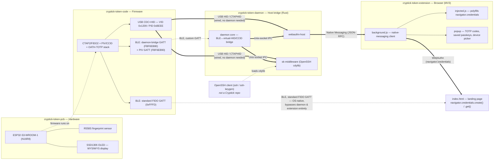

# Cryptick Token — Ecosystem Architecture

This repository is the only place that documents how the four Cryptick Token
repos relate **at runtime**, not just as Git submodules. Each submodule's own
README is deliberately self-contained and has no cross-repo links — this doc
is where the full picture lives.

Scope: this is the ecosystem-level view (which repo talks to which, over what
transport). For implementation detail on any one component, read that
submodule's own `README.md` / `docs/ARCHITECTURE.md` / `PROJECT.md` — links are
in the "Further reading" section below. Nothing here goes beyond what those
documents already establish.

## The pipeline

## Walking the chain

1. **Hardware → firmware.** The PCB (`cryptick-token-pcb`) carries the
   ESP32-S3-WROOM-1 MCU, the R558S fingerprint sensor, and the SSD1306 OLED.
   The firmware (`cryptick-token-code`) runs on that MCU and implements the
   CTAP2/FIDO2, PIV/CCID, and OATH-TOTP protocol stacks on top of the HAL the
   PCB exposes (fingerprint UART, OLED I2C, GPIO nav).
2. **Firmware → daemon, two ways.**
   - **Wired (USB):** the device enumerates as a standard USB HID (VID
     `0x1209` / PID `0xBEEE`). Any USB CTAPHID-speaking host component —
     the daemon's `webauthn-host` or `sk-middleware` — talks to it directly.
     No daemon process is required for the wired path; this is the one that
     works end to end today.
   - **Wireless (BLE):** the firmware exposes three separate GATT services —
     a standard FIDO BLE service (`0xFFFD`) left untouched by Cryptick's own
     software so native OS/browser BLE stacks can use it directly, plus two
     custom services (`FBF6EB80` for CTAP framing, `FBF6EB90` for PIV APDUs)
     that only `cryptick-token-daemon` speaks. The daemon's whole job is to
     make that BLE side look like a USB device to the rest of the host.
3. **Daemon → browser.** The daemon's `webauthn-host` binary is what the
   browser extension launches as its native-messaging host
   (`com.cryptick.webauthn`). It either talks straight to the USB HID
   interface, or — for a wireless device — forwards over a local Unix-socket
   IPC connection to the daemon core, which relays to/from the BLE bridge
   GATT service.
4. **Browser extension → website.** `cryptick-token-extension` injects a
   script into the page (`injected.js`) that intercepts
   `navigator.credentials.create()` / `.get()` calls, hands them to the
   background service worker, which speaks native-messaging JSON-RPC to
   `webauthn-host`. The resulting assertion flows back up the same path to
   the calling page — any WebAuthn relying party, including this repo's own
   `index.html` landing page, which demonstrates the flow with its own
   interactive simulator.
5. **A parallel path for SSH.** `sk-middleware` is an OpenSSH
   `SecurityKeyProvider` cdylib loaded directly by `ssh-keygen` / `ssh`. It
   reaches the device the same two ways as `webauthn-host` — direct USB, or
   daemon IPC over the BLE bridge — independent of the browser extension.

## Transports at each hop

| Hop | Transport | Repos involved | Notes |
| --- | --- | --- | --- |
| MCU ↔ fingerprint / OLED | UART / I2C | pcb ↔ code | On-board peripherals, not inter-repo |
| Firmware ↔ host (wired) | USB HID (CTAPHID + OATH APDUs) | code ↔ daemon | Works today, no daemon process needed |
| Firmware ↔ daemon (wireless) | BLE, custom GATT (`FBF6EB80` CTAP, `FBF6EB90` PIV) | code ↔ daemon | Core framing (`ble-framing`, `ctap`, `ctaphid`, `ipc` crates) is implemented; the real radio integration (`transport-ble`) and OS virtual-HID glue (`vhid-linux`, `vhid-windows`) are not — see Status below |
| Firmware ↔ native OS (wireless) | BLE, standard FIDO GATT (`0xFFFD`) | code only | Daemon deliberately never touches this service; relies on the OS/browser's own BLE FIDO2 support |
| Daemon core ↔ `webauthn-host` / `sk-middleware` | Unix-socket IPC | daemon (internal) | Only exercised for the BLE path |
| `webauthn-host` ↔ extension | Native Messaging (JSON-RPC), host id `com.cryptick.webauthn` | daemon ↔ extension | |
| Extension ↔ web page | WebAuthn (`navigator.credentials`) | extension ↔ website | Any relying party, including this repo's `index.html` |
| `sk-middleware` ↔ OpenSSH | cdylib `SecurityKeyProvider` | daemon ↔ (external OpenSSH) | `ssh-keygen -t ed25519-sk` works today against the USB path |

## Implementation status (grounded in each submodule's own docs)

- **USB passkeys, OATH-TOTP, and OpenSSH hardware keys work end to end today**
  — the wired path needs no daemon at all, and `sk-middleware` is confirmed
  working against a real `ssh-keygen` round trip.
- **BLE as a CTAP bridge is partially built.** The daemon's own status table
  marks the framing/CTAP/IPC crates "done," but the actual radio transport
  and the OS-side virtual-HID adapters are not started, so wireless passkeys
  through the daemon are not yet usable end to end.
- **PIV / smart-card OS login is designed but not finished.** The firmware's
  PIV applet and CCID protocol layer are implemented and unit-tested; the
  USB CCID *interface* binding and the BLE PIV service are written but
  unverified on real hardware; and `cryptick-token-code`'s own
  `docs/MAC_LOGIN.md` says explicitly: "do not claim finished Mac login."
  Treat macOS SmartCard pairing and Linux PAM login as in-progress, not
  shipped.
- **Standard native BLE FIDO (`0xFFFD`) is present in firmware but not a
  reliable path today** — `cryptick-token-daemon`'s own research notes that
  Chrome dropped BLE CTAP2 support in 2020 and current OS/browser support is
  limited, which is the whole reason the daemon's custom-GATT bridge exists.

## Further reading

- [`cryptick-token-pcb/README.md`](../cryptick-token-pcb/README.md) — hardware specs, pinouts, fabrication
- [`cryptick-token-code/README.md`](../cryptick-token-code/README.md) · [`docs/ARCHITECTURE.md`](../cryptick-token-code/docs/ARCHITECTURE.md) · [`docs/MAC_LOGIN.md`](../cryptick-token-code/docs/MAC_LOGIN.md) · [`docs/BLE_FIDO.md`](../cryptick-token-code/docs/BLE_FIDO.md) — firmware layers, PIV status, BLE framing
- [`cryptick-token-daemon/README.md`](../cryptick-token-daemon/README.md) · [`PROJECT.md`](../cryptick-token-daemon/PROJECT.md) · [`docs/ARCHITECTURE.md`](../cryptick-token-daemon/docs/ARCHITECTURE.md) · [`docs/COMPUTER_LOGIN.md`](../cryptick-token-daemon/docs/COMPUTER_LOGIN.md) — transport mechanisms, GATT service map, PIV/VPCD relay
- [`cryptick-token-extension/README.md`](../cryptick-token-extension/README.md) — extension bridge, installation

A research memo also lives under [`docs/research/`](research/) —
[`multi-device-and-credential-sync.md`](research/multi-device-and-credential-sync.md).
It is an exploratory note, not implemented architecture, and is intentionally
kept separate from this document.
